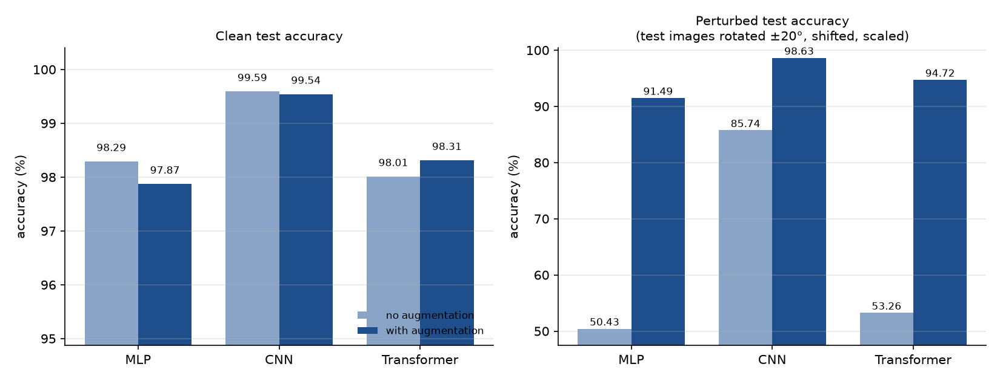
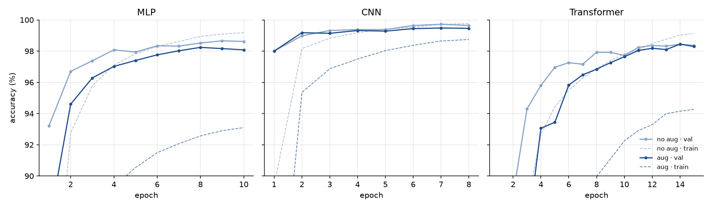

# ai-hw-fall-2026-nn — small image-recognition networks on MNIST

Three small neural networks trained on the MNIST **train** split and evaluated on the MNIST **test** split, each with and without image augmentation:

| Model | Idea |
|---|---|
| **MLP** (shallow) | Flatten the 28×28 image → one hidden layer of 256 → 10 classes |
| **CNN** | Two conv blocks (conv-BN-ReLU ×2 + max-pool), 28→14→7, then a small classifier |
| **Transformer encoder** | Tiny ViT: 16 patches of 7×7 → 64-d tokens + [CLS] + position embeddings → 4 encoder layers |

## Results

Numbers below are filled in automatically by `run_all.py` (on GitHub Actions or locally).

<!-- RESULTS:START -->
| Model | Augmentation | Params | Epochs | Train time | Val acc | **Test acc** | Test errors | Perturbed-test acc |
|---|---|---:|---:|---:|---:|---:|---:|---:|
| MLP | no | 203,530 | 10 | 54s | 98.66% | **98.29%** | 171 | 50.43% |
| MLP | yes | 203,530 | 10 | 86s | 98.24% | **97.87%** | 213 | 91.49% |
| CNN | no | 468,010 | 8 | 527s | 99.72% | **99.59%** | 41 | 85.74% |
| CNN | yes | 468,010 | 8 | 547s | 99.48% | **99.54%** | 46 | 98.63% |
| Transformer | no | 139,018 | 15 | 398s | 98.44% | **98.01%** | 199 | 53.26% |
| Transformer | yes | 139,018 | 15 | 439s | 98.44% | **98.31%** | 169 | 94.72% |

Device: cpu
<!-- RESULTS:END -->




Per-model confusion matrices and misclassified digits: `results/confusion_*.png`, `results/mistakes_*.png`.
Full numbers: `results/summary.csv`, `results/test_*.json`, `results/history_*.json`.
Slides: [`presentation/MNIST_NN_Presentation.pdf`](presentation/MNIST_NN_Presentation.pdf).

## Method

- **Data split.** Train on the 60,000-image train split; the last 5,000 of those are held out as validation to pick the best epoch. The 10,000-image test split is used only once, for the final score — never for any decision.
- **Training.** AdamW (weight decay 1e-4), one-cycle learning-rate schedule, cross-entropy with label smoothing 0.05, batch 128, seed 42.
- **Augmentation** (training images only): random rotation ±12°, shift ±12%, scale 0.88–1.12, shear ±8°, and random erasing of a small patch. No flips — a mirrored digit is a different symbol.
- **Robustness test.** Besides the standard clean test accuracy, every model is also scored on the same test images randomly rotated ±20°, shifted 15% and scaled 0.85–1.15 (same random perturbations for every model). This shows what augmentation buys beyond the clean number.

## Run it

### On GitHub (no setup)
The workflow in `.github/workflows/train.yml` installs PyTorch on a GitHub runner, trains and tests all six experiments, builds the PDF and commits `results/`, `presentation/` and `saved_models/` back to the repo. It runs on every push that changes the code, or manually: **Actions → Train and test on MNIST → Run workflow**.

### Locally
```bash
pip install -r requirements.txt
python run_all.py             # train + test all 6 experiments, write results/
python make_presentation.py   # build presentation/MNIST_NN_Presentation.pdf
```

Single models:
```bash
python train.py --model mlp
python train.py --model cnn --augment
python train.py --model transformer --augment --epochs 20

python test.py --model cnn --model-path saved_models/cnn_aug.pth
```

## Files

```
models.py             MLP, CNN, Transformer encoder
data.py               MNIST loading, train/val split, augmentation
train.py              train one model on the train split
test.py               evaluate on the test split (+ confusion matrix, mistakes, robustness)
run_all.py            run all experiments and build summary tables/charts
make_presentation.py  build the PDF slide deck from results/
results/              test results, charts, training histories
saved_models/         trained weights (.pth)
presentation/         PDF slides
```
